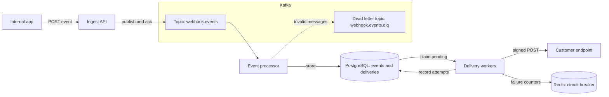
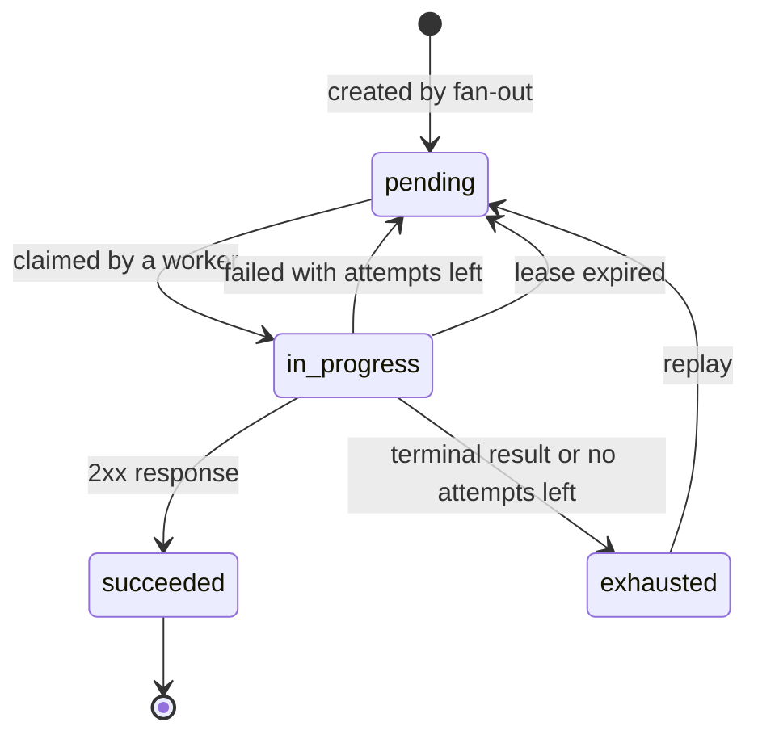
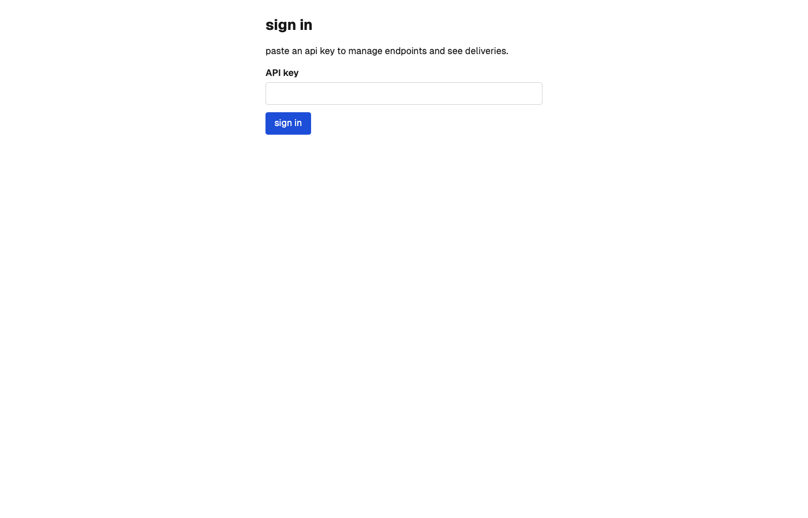
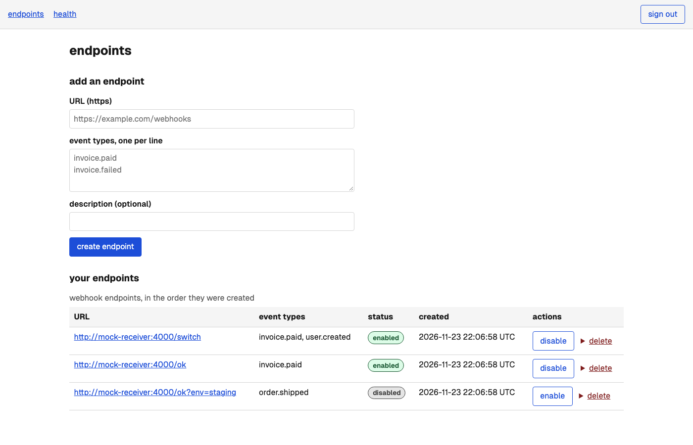
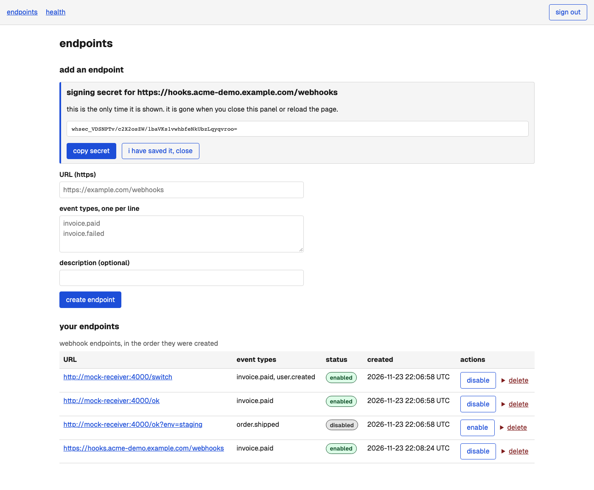
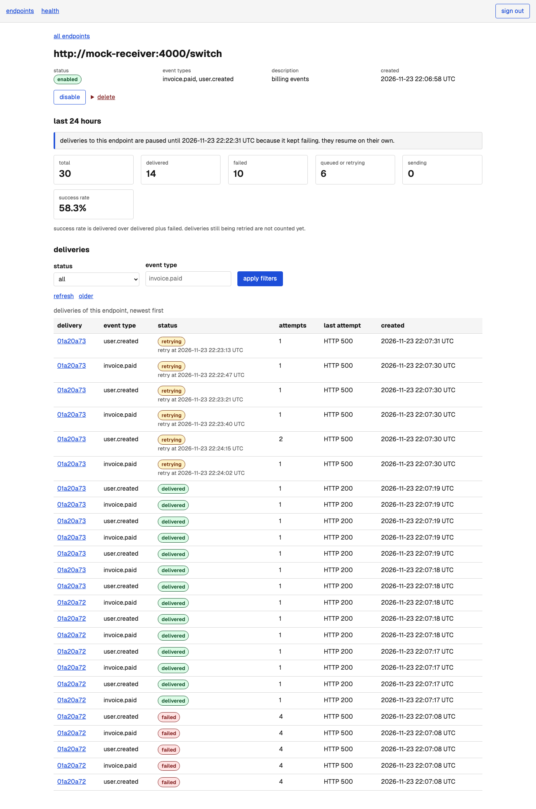

# web-hooks

a reusable starter template for building reliable webhooks and connecting any backend service to another.

## How it works



- An internal app posts an event to the ingest API, which publishes it to Kafka and answers 202 only after the broker acknowledges.
- The event processor reads the topic in batches and sends invalid messages to the dead letter topic.
- In one Postgres transaction it stores the event and writes a pending delivery for each matching endpoint, then commits the Kafka offsets.
- Delivery workers claim pending rows, send a signed POST to the customer endpoint, and record every attempt in Postgres.
- Failed attempts are retried with backoff, and Redis counters let a circuit breaker pause a failing endpoint.
- Customers manage endpoints, watch deliveries and replay failures through the REST API and the Next.js dashboard.
- A pnpm and Turborepo monorepo on Node 24: `apps/api` (Express 5, Prisma 7, also the processor and worker), `apps/web` (Next.js 16) and `packages/shared` (zod schemas).

## Delivery guarantees

- At least once to the customer's server, not exactly once.
- `webhook-id` is the delivery id and is identical on every attempt, so receivers dedupe on it.
- The ingest API returns 202 only after Kafka acknowledges the write.
- Requests are signed with the Standard Webhooks scheme (`webhook-id`, `webhook-timestamp`, a `v1,` HMAC-SHA256 `webhook-signature`) using the endpoint's `whsec_` secret.
- Up to 8 attempts, waiting 5 s, 30 s, 2 min, 10 min, 30 min, 2 h and 6 h between them with plus or minus 20% jitter. `Retry-After` on 429 and 503 can raise the wait, up to 6 h.
- A delivery older than 24 h, an HTTP 410, a blocked address or a disabled endpoint ends as exhausted with no more retries.
- After 20 consecutive failures the circuit breaker pauses an endpoint for 5 minutes.
- A worker's lease lasts 60 s, then a reaper returns the row to pending, drawing from the same 8 attempts.
- `exhausted` means we stopped trying, not that nothing arrived.

## Delivery status



## Key design decisions

| Decision | Reason |
| --- | --- |
| Kafka for ingestion | The event is durable before the internal app hears 202, and the processor can fall behind without losing data. |
| Postgres as the queue, claimed with `FOR UPDATE SKIP LOCKED` | Workers never block each other or claim the same row. |
| Lease and fenced writes | A crashed worker's row is recovered, and a late result from a worker that lost its lease is discarded. |
| Save downstream first, ack upstream second | A crash replays a batch instead of losing it, and unique `(event_id, endpoint_id)` absorbs the duplicates. |
| SSRF check at delivery time | DNS can change after registration, so the address the socket connects to is the one checked. |
| Redis for breaker counters | Volatile but uncontended, and if Redis is down delivery simply continues. |
| uuidv7 ids with keyset pagination | Id order is creation order, so lists use `id < cursor` and stats use a uuid lower bound, with no `created_at` index. |

## Dashboard

Open `http://localhost:3000` and sign in with an API key.

<figure>
  
  <figcaption>Sign in with an API key, which is checked against the API before the session cookie is set.</figcaption>
</figure>

<figure>
  
  <figcaption>The endpoints page lists each endpoint with its event types and status, and lets you enable, disable or delete it.</figcaption>
</figure>

<figure>
  
  <figcaption>The signing secret panel, shown once right after an endpoint is created and gone on reload.</figcaption>
</figure>

<figure>
  
  <figcaption>An endpoint with last 24 hours stats and a mix of delivered, retrying and failed deliveries. The banner shows the pause from a tripped circuit breaker.</figcaption>
</figure>

<figure>
  
  <figcaption>A failed delivery with all four attempts listed and the replay button.</figcaption>
</figure>

## Run it locally

```bash
cp .env.example .env
pnpm install
docker compose up -d postgres redis
pnpm dev
```

Web runs on port 3000 and api on port 3001. This starts the api and web only, so events need the full stack below. Create an organization and key with `pnpm --filter api create-org <name>`. `GET /health` is readiness (Redis and Kafka are reported but not required) and `GET /health/live` is liveness.

```bash
pnpm verify
```

Builds the images and starts postgres, redis, kafka, api, processor, one delivery worker and web, plus the one-shot kafka-init that creates the topics, then checks the api health endpoint and that the web page says `api: ok`. Stop with `docker compose down`. The mock receiver, a fake customer for the smoke scripts, needs `--profile test`.

Design docs for each feature live in `apps/docs`: [webhook registration](apps/docs/webhook-registration), [event ingestion](apps/docs/event-ingestion), [matching and fan-out](apps/docs/matching-fanout), [delivery](apps/docs/delivery), [retries and exhaustion](apps/docs/retries-exhaustion) and [delivery dashboard](apps/docs/delivery-dashboard).
