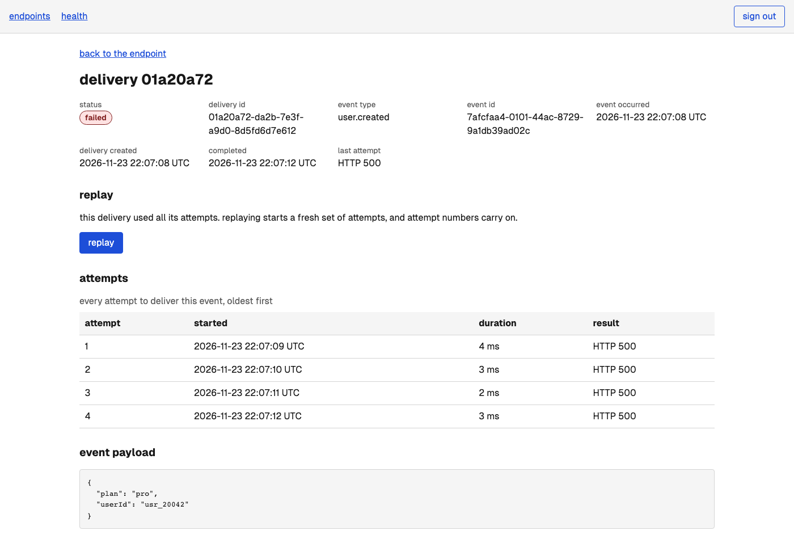

# web-hooks

Reliable multi-tenant webhook delivery system, built feature by feature. This repo is the scaffold: a working local environment with no webhook logic yet.

## Stack

- Turborepo, pnpm workspaces, Node 24, TypeScript 7
- `apps/api`: Express 5, Prisma 7 (PostgreSQL), ioredis
- `apps/web`: Next.js 16
- `packages/shared`: zod schemas shared by api and web, compiled to `dist`
- PostgreSQL 18 and Redis 8 through Docker Compose

## Local development

```bash
cp .env.example .env
pnpm install
docker compose up -d postgres redis
pnpm dev
```

Web runs on port 3000 and api on port 3001.

## Full stack in containers

```bash
pnpm verify
```

Builds both images, starts all four services, waits for healthy, then checks the api and the web page. Stop with `docker compose down`.

## Dashboard

Open `http://localhost:3000` and sign in with an API key.

<figure>
  
  <figcaption>Sign in with an API key, which is checked against the API before the session cookie is set.</figcaption>
</figure>

<figure>
  
  <figcaption>The endpoints page lists each endpoint with its event types and status, and lets you enable, disable or delete it.</figcaption>
</figure>

<figure>
  
  <figcaption>The signing secret panel, shown once right after an endpoint is created and gone on reload.</figcaption>
</figure>

<figure>
  
  <figcaption>An endpoint with last 24 hours stats and a mix of delivered, retrying and failed deliveries. The banner shows the pause from a tripped circuit breaker.</figcaption>
</figure>

<figure>
  
  <figcaption>A failed delivery with all four attempts listed and the replay button.</figcaption>
</figure>

## Health endpoints

- `GET /health/live`: liveness, no dependency checks
- `GET /health`: readiness, 200 when PostgreSQL is reachable and 503 otherwise, Redis is reported but not required

## Adding features

Kafka arrives with event ingestion. Prisma models, migrations and webhook logic arrive feature by feature.